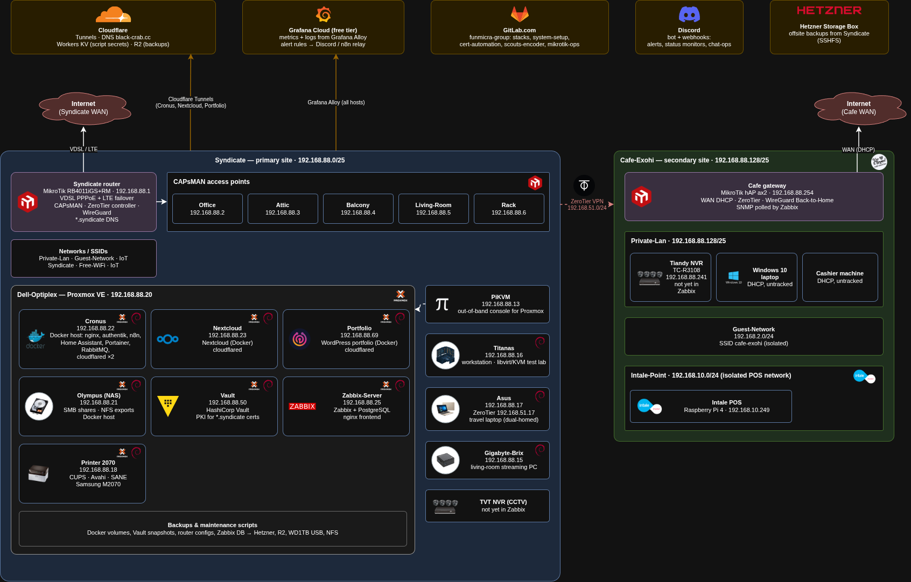

# My DevOps Home-Lab / Syndicate

Documentation for my two-site home lab. I use it to practise DevOps and systems engineering on real infrastructure that my family and I rely on every day.

## ✍️ About Me

I learn by building and running things. The lab started in July 2018 and I keep reworking it as I learn new tools.

Want to connect or collaborate? [Email me](mailto:el.funmicra@gmail.com).

---

# 🖧 Network Topology

| Site | Name | Subnet | Role |
|---|---|---|---|
| A | **Syndicate** | `192.168.88.0/25` | Primary: home lab and household |
| B | **Cafe-Exohi** | `192.168.88.128/25` | Secondary: small family café |

The two sites are joined by a **ZeroTier** site-to-site VPN. The Syndicate router runs the ZeroTier controller. Remote access uses SSH over the VPN, with MikroTik Back-to-Home WireGuard as a fallback.

---

## 🏠 Syndicate

### 🛠️ Hardware

- **6U wall-mounted rack** with a 24-port patch panel and an unmanaged 24-port switch
- **MikroTik RB4011:** core router, firewall, and CAPsMAN controller. WAN is VDSL (PPPoE) with LTE failover.
- **5 MikroTik access points** managed through CAPsMAN
- **Dell OptiPlex:** runs Proxmox VE
- **PiKVM:** out-of-band access to the Proxmox host
- **Workstation (Debian 13):** daily driver, with a local libvirt/KVM test lab
- **CCTV:** 5 cameras on an NVR

### 🌐 Networks
- **Private LAN:** trusted devices and servers
- **Guest:** internet-only
- **IoT:** isolated smart devices
- **DNS:** the router resolves the internal `*.syndicate` domain itself. AdGuard Home used to do this, and I retired it.

### 💻 Virtualization (Proxmox)

| VM | Role |
|---|---|
| **Cronus** | Docker host: reverse proxy, dashboards, SSO, n8n automation, Portainer |
| **Nextcloud** | Self-hosted cloud storage for family |
| **Portfolio** | Dockerized WordPress portfolio |
| **Olympus** | NAS (SMB and NFS) plus Docker |
| **Vault** | HashiCorp Vault for secrets and PKI |
| **Zabbix-Server** | Zabbix with a PostgreSQL backend |
| **Print server** | CUPS, Avahi and IPP-USB for a USB laser printer |

### 🔐 Services

| Service | Purpose | Exposure |
|---|---|---|
| **nginx reverse proxy** | TLS termination for all `*.syndicate` services | Internal |
| **Authentik** | SSO (OIDC and forward-auth) in front of Portainer, n8n and WordPress login | Public |
| **Nextcloud** | Files, calendar and contacts | Public |
| **Portfolio (WordPress)** | Project showcase | Public |
| **n8n** | Automation (backups, fleet upgrades, chat-ops) | Public, behind SSO |
| **Portainer** | Docker management | Internal |
| **Home Assistant** | Smart-home hub | Internal |
| **HashiCorp Vault** | Secrets, PKI and certificate issuance | Internal |

Public services are published through **Cloudflare Tunnel** on my own domain.

---

## 🏢 Cafe-Exohi

A lighter footprint: a MikroTik hAP ax² gateway, 3 access points, an isolated POS network, and CCTV.

- **Private LAN:** office devices
- **Guest:** client-isolated Wi-Fi
- **POS network:** a separate subnet for the Raspberry Pi 4 running a self-hosted point-of-sale system
- **Gateway:** hAP ax² with ZeroTier back to Syndicate, monitored over SNMP

---

## ⚙️ Automation & CI/CD

All infrastructure code lives in GitLab (`funmicra-group`), with pipelines running on a self-hosted runner.

- **Ansible:** deploys bootstrap scripts, per-host config and cron jobs across the fleet
- **GitLab CI:** app-stack deploys, system bootstrap, and a Vault PKI certificate pipeline that ends in an nginx reload
- **Scripts:** idempotent Bash with `set -Euo pipefail`, dry-run flags for anything destructive, and shared libraries for secrets lookup and notifications
- **Secrets:** scripts keep no secrets on disk. They resolve them at runtime from Cloudflare Workers KV (migrating to Vault), using a small per-script bootstrap file.

---

## 📈 Monitoring & Alerting

- **Zabbix:** host, service and SNMP monitoring. Alerts are routed by host group and severity.
- **Grafana Cloud:** Grafana Alloy ships logs and metrics from every host. I use it for dashboards and log search.
- **RabbitMQ:** one alerting broker that all scripts publish to. It fans out to per-category Discord channels, so no script holds a webhook URL.
- **Discord:** the notification surface for alerts, backups, updates and cert renewals.

---

## 💾 Backups

Backups cover Docker volumes and env files, Vault snapshots, RabbitMQ definitions, MikroTik configs, the Zabbix database and home directories. They go to several places:

- NFS on the NAS
- A USB drive on the NAS
- Cloudflare R2
- A Hetzner storage box

Each job reports success or failure to Discord. I have proven a restore for some of them (RabbitMQ definitions so far) and still need to do it for the rest.

---

## 🧰 Stack at a glance

`Proxmox` · `Debian` · `Docker` · `Ansible` · `GitLab CI` · `Bash` · `systemd` · `MikroTik RouterOS` · `ZeroTier` · `Cloudflare Tunnel / Workers KV / R2` · `HashiCorp Vault` · `Authentik` · `Zabbix` · `Grafana Cloud` · `RabbitMQ` · `n8n` · `Nextcloud`

---

## 📜 History

- Previously self-hosted Jenkins, AdGuard Home, Uptime Kuma and a Loki/Promtail stack. They are now replaced by GitLab CI, router DNS, Zabbix and Grafana Cloud.
- K3s, ArgoCD and Kargo run as a separate learning cluster, not part of production here.
